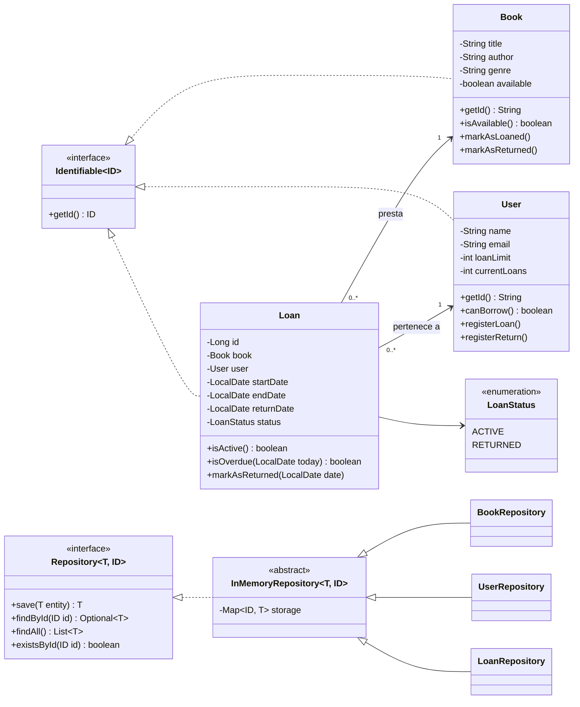
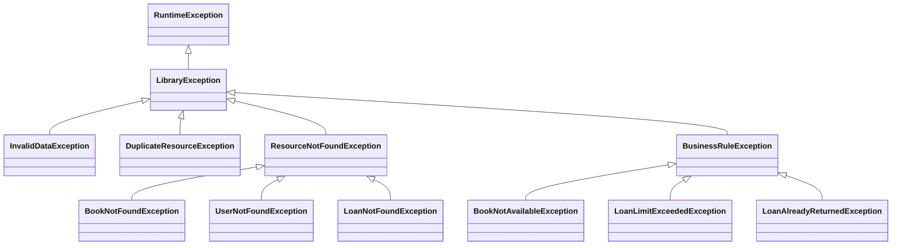

# Fase 1 — Diagrama de clases

## Excepciones

## Relaciones

- **Loan → Book / User: asociación.** El préstamo referencia a un libro y a un usuario que existen de forma independiente; borrar un préstamo no borra al libro ni al usuario. Un libro o un usuario pueden tener muchos préstamos en el tiempo, pero un libro solo tiene un préstamo `ACTIVE` a la vez.
- **Loan → LoanStatus: composición.** El estado no existe fuera del préstamo.
- **Identificadores:** el libro se identifica por su título, el usuario por su email (lo que pide el enunciado y usa la API) y el préstamo por un `Long` secuencial.
